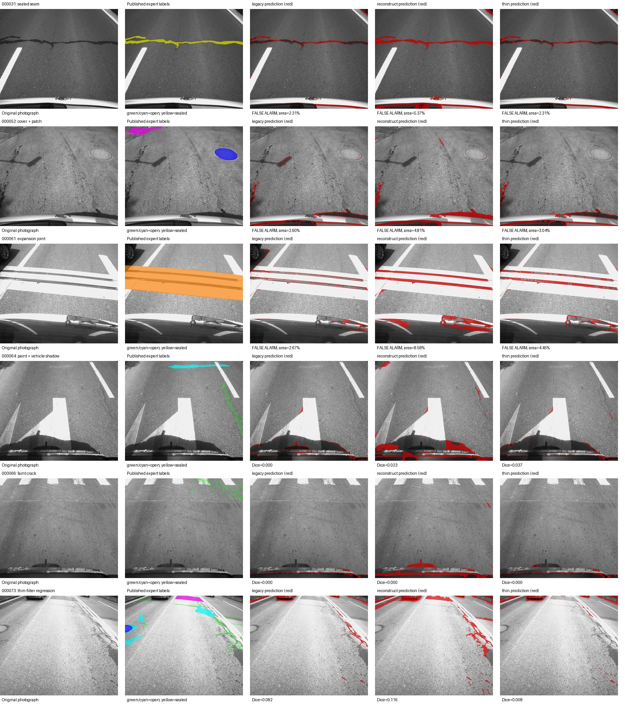
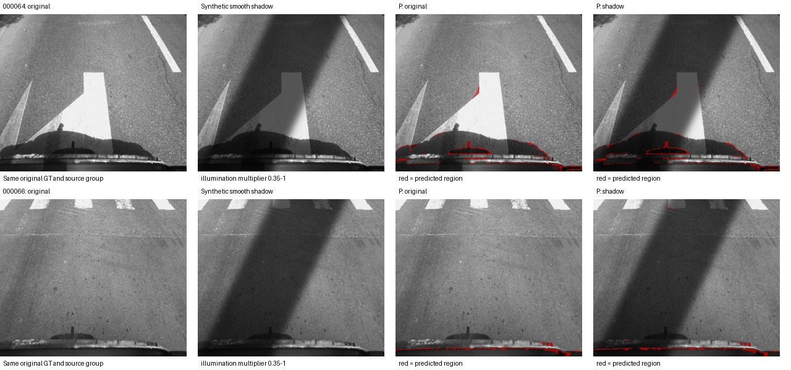

# Kiểm chứng trên ảnh đường thật và trường hợp dễ gây nhầm

**Không ứng viên nào được chấp nhận.** Tái tạo vùng (`reconstruct`) và trung vị 3×3 (`thin`) tăng Dice trung bình một ít nhưng làm tăng báo nhầm trên nguồn ngoài, không đạt tiêu chí đã đặt trước. Cả hai bị loại khỏi app và pipeline dùng thực tế; mã còn ở `code/experiments.py` chỉ để tái hiện nghiên cứu. Baseline `P` cũng thất bại rõ khi đổi miền dữ liệu, nên việc giữ `P` không phải tuyên bố rằng nó đủ tin cậy ngoài thực tế.

## Nguồn và định nghĩa nhãn

Đã dùng **toàn bộ 100 ảnh và 100 mặt nạ pixel công khai** của [FuturePave/PaveSeg-Dataset](https://github.com/FuturePave/PaveSeg-Dataset/tree/dc21495f61867c94336283636959c754d192e18a), cố định tại commit `dc21495f61867c94336283636959c754d192e18a`. Đây là bản preview của bộ dữ liệu, không phải toàn bộ 2.400 ảnh được mô tả trong tài liệu nguồn. Giấy phép repository là [Apache-2.0](https://github.com/FuturePave/PaveSeg-Dataset/blob/dc21495f61867c94336283636959c754d192e18a/LICENSE), có [bản sao kèm bằng chứng](benchmarks/external/PaveSeg-LICENSE.txt). GT dùng nguyên mặt nạ đa lớp do nguồn cung cấp, không sinh từ đầu ra pipeline.

Ảnh có kích thước 1280×1080. [Manifest cố định](benchmarks/external/manifest.json) chứa URL gốc, mã băm SHA-256 của ảnh/GT, kích thước, nhãn và split cho từng ảnh. Mã tải kiểm tra lại băm trước khi đánh giá.

Tác vụ ở đây là phát hiện **vết nứt hở**: gộp nhãn `crack=30` và `alligator=150` thành GT dương. Các nhãn `background=0`, `pothole=60`, `sealed=90`, `patch=120`, `cover=180`, `joint=210` là âm đối với tác vụ này. Vì vậy "ảnh âm" có thể chứa hố, vệt trám hoặc khe nối; không đồng nghĩa mặt đường hoàn toàn lành. Tổng cộng có **64 ảnh dương, 36 ảnh âm** theo định nghĩa này.

Nhãn alligator thường phủ một vùng hư hỏng thô, khác mặt nạ nét nứt mảnh của CFD/PCS. Đây là hạn chế khi diễn giải Dice và là một phần của sự khác miền dữ liệu; không nên so trực tiếp số Dice này với bảng PCS lịch sử.

## Chia tập và tiêu chí trước khi xem điểm

[Protocol](../plans/external-stress-validation.md) và manifest được cố định trước khi chấm ứng viên. Mười khối ID liên tiếp, mỗi khối 10 ảnh, được chia bằng seed 42:

| Tập | Khối ID | Ảnh dương | Ảnh âm | Vai trò |
|---|---|---:|---:|---|
| Discovery | 0, 3, 5, 6, 7 | 33 | 17 | So sánh `P`, `reconstruct`, `thin` đã cố định |
| Confirmation | 1, 2, 4, 8, 9 | 31 | 19 | Chỉ chạy baseline sau khi cả hai ứng viên bị loại |

Không tìm thấy ảnh trùng băm. Sàng lọc thumbnail xám 64×54 với MAE < 5 không gắn cờ cặp gần trùng qua hai tập. Tuy vậy, ID khối và phép sàng lọc này **không chứng minh các cảnh độc lập**: nguồn không công bố session chụp. Toàn bộ ảnh đến từ **một nguồn**, nên không đáp ứng mục tiêu nhiều nguồn độc lập ban đầu. Dữ liệu này đủ phát hiện ứng viên tệ hơn, chưa đủ xác nhận khả năng tổng quát qua nhiều nguồn.

Tiêu chí chính yêu cầu Dice ảnh dương tăng ít nhất **0,02 tuyệt đối**, IoU tăng; Precision/Recall không giảm quá 0,01; không có thêm ảnh âm bị báo nhầm, diện tích dự đoán âm trung bình/tối đa không tăng, và không có ảnh dương giảm Dice quá 0,05. Tiêu chí đầy đủ còn kiểm tra theo nhóm, tính đúng đầu ra, thời gian và bằng chứng độc lập qua nguồn. Không thay tham số sau khi xem kết quả ngoài, không lấy confirmation để chọn lại ứng viên.

## Kết quả ảnh gốc trên discovery

Dice/IoU/Precision/Recall chỉ tính trung bình trên **33 ảnh dương**. Báo nhầm tính riêng trên **17 ảnh âm**: dự đoán bất kỳ pixel nào là một báo nhầm. Không trộn Dice = 1 của ảnh âm dự đoán rỗng vào điểm phân đoạn dương.

| Phương pháp | Dice dương | IoU dương | Precision | Recall | Báo nhầm ảnh âm | Diện tích âm TB | Diện tích âm lớn nhất |
|---|---:|---:|---:|---:|---:|---:|---:|
| `P` / legacy | 0.0178 | 0.0095 | 0.0359 | 0.0177 | 12/17 | 1.365% | 3.972% |
| reconstruct | 0.0297 | 0.0161 | 0.0249 | 0.0795 | 17/17 | 4.311% | 8.576% |
| thin | 0.0291 | 0.0157 | 0.0308 | 0.0602 | 16/17 | 1.969% | 4.454% |

Reconstruct chỉ tăng Dice **0,0118**, giảm Precision khoảng **0,0110**, đồng thời biến cả 5 ảnh âm từng được baseline trả rỗng thành báo nhầm. Thin chỉ tăng **0,0112**, tăng báo nhầm và có ảnh giảm Dice **0,0742**. Cả hai không vượt tiêu chí, bất kể chưa đạt điều kiện nhiều nguồn.

Thời gian trên máy đo: baseline khoảng **19,7 ms**, reconstruct **23,0 ms**, thin **20,1 ms** cho ảnh gốc. Mỗi trường hợp khởi động một lần rồi lấy trung vị ba lần chạy pipeline, một luồng OpenCV. Đây là thời gian tính pipeline, chưa gồm đọc ảnh/ghi file; nhanh hơn không bù được suy giảm chất lượng.

Xem [tổng hợp discovery](benchmarks/external/discovery/summary.csv), [từng ảnh](benchmarks/external/discovery/per_image.csv), [kết quả kiểm tra tiêu chí](benchmarks/external/discovery/gate.json) và [cấu hình/môi trường](benchmarks/external/discovery/metadata.json).

## Biến đổi gây khó và kiểm tra ổn định

Mỗi ảnh được chạy nguyên bản và năm biến đổi cố định: lật ngang, gamma 0,75, gamma 1,25, JPEG chất lượng 60, bóng đổ chéo tổng hợp bằng hệ số chiếu sáng trơn 0,35–1. GT được lật cùng ảnh khi cần. Những biến thể vẫn thuộc cảnh gốc, **không phải ảnh thật độc lập bổ sung**. Bóng tổng hợp là thử độ ổn định ánh sáng; không thay thế bằng chứng bóng ngoài đời.

| Điều kiện | Dice dương `P` | reconstruct | thin | Kết luận hai ứng viên |
|---|---:|---:|---:|---|
| Ảnh gốc | 0.0178 | 0.0297 | 0.0291 | Không đạt |
| Lật ngang | 0.0178 | 0.0297 | 0.0290 | Không đạt |
| Gamma 0,75 | 0.0168 | 0.0238 | 0.0355 | Không đạt |
| Gamma 1,25 | 0.0191 | 0.0292 | 0.0290 | Không đạt |
| JPEG 60 | 0.0153 | 0.0299 | 0.0265 | Không đạt |
| Bóng đổ tổng hợp | 0.0116 | 0.0218 | 0.0186 | Không đạt |

Không biến đổi nào đủ mức tăng Dice yêu cầu. Cả hai làm tăng diện tích báo nhầm âm ở mọi điều kiện. Với gamma 1,25, thin còn trả rỗng một ảnh dương mà baseline trả khác rỗng (`000078`). Baseline vốn có Dice = 0 ở ca này, nên đây là thay đổi quyết định mức ảnh, không phải bằng chứng mất một vết nứt từng phân đoạn đúng. Các lỗi báo nhầm và giảm Dice ở những ca khác đã đủ loại ứng viên.

## Các ca cần xem trực tiếp

Các ảnh dưới đây là ví dụ giải thích thất bại, không phải tập con dùng chọn điểm:

| ID | Trường hợp | Quan sát ở ảnh gốc |
|---|---|---|
| `000031` | Vệt trám, nhãn sealed | `P` vẫn tô khoảng 2,31% ảnh thành nứt |
| `000052` | Vùng vá/nắp | `P` tô khoảng 2,60% ảnh dù không có nứt hở theo GT |
| `000061` | Khe nối | `P` tô khoảng 2,67% ảnh, nhầm đường nối với nứt |
| `000064` | Nứt cùng bóng/vạch sơn | Dice `P` = 0: chi tiết tối nổi bật chưa đủ nhận đúng lớp nứt |
| `000066` | Nứt mảnh | Dice = 0 ở cả ba phương pháp; giảm trung vị không tự giải quyết được |
| `000073` | Nứt thật có cấu trúc dễ nhầm | Dice từ 0,0822 của `P` giảm xuống 0,0081 với thin |





## Confirmation chỉ chẩn đoán baseline

Sau khi loại cả hai ứng viên trên discovery, không chạy ứng viên nào trên confirmation để tìm lựa chọn thay thế. Chỉ chạy `P` đã giữ nguyên trên 50 ảnh còn lại và sáu điều kiện:

| Điều kiện | Dice trên 31 ảnh dương | Báo nhầm trên 19 ảnh âm |
|---|---:|---:|
| Ảnh gốc | 0.0337 | 15/19 |
| Lật ngang | 0.0337 | 15/19 |
| Gamma 0,75 | 0.0390 | 15/19 |
| Gamma 1,25 | 0.0337 | 15/19 |
| JPEG 60 | 0.0363 | 15/19 |
| Bóng đổ tổng hợp | 0.0337 | 15/19 |

Ở ảnh gốc, IoU dương = **0,0198**, Precision = **0,0418**, Recall = **0,0603**. Diện tích dự đoán trên ảnh âm trung bình **1,251%**, tối đa **3,244%**. Gộp hai tập ảnh gốc, baseline báo nhầm **27/36 ảnh âm, tức 75%**. Kết quả xác nhận hạn chế của baseline trong miền này; không phải bằng chứng xác nhận một cải tiến. Xem [tổng hợp confirmation](benchmarks/external/confirmation/summary.csv), [từng ảnh](benchmarks/external/confirmation/per_image.csv) và [metadata](benchmarks/external/confirmation/metadata.json).

## Tái hiện và quyết định giữ mã

```bash
python code/external_data.py --download
python code/stress_eval.py --split discovery --output results/external-discovery
python code/stress_eval.py --split confirmation --variants legacy --output results/external-confirmation
```

Ảnh/nhãn tải về trong `data/`, dự đoán trong `results/` được git bỏ qua. Repository lưu manifest, số liệu và gallery kèm nguồn để kiểm tra. Metadata của lần chạy ghi mã băm pipeline tại thời điểm đánh giá; việc chuyển ứng viên sang module nghiên cứu sau đó làm thay mã băm file nhưng giữ thuật toán và cấu hình thí nghiệm.

Gallery là bản thu nhỏ và phủ màu từ ảnh/nhãn của FuturePave/PaveSeg-Dataset tại commit đã ghi ở trên, phân phối theo Apache-2.0 kèm LICENSE. Màu GT: xanh lá = crack, xanh lơ = alligator, vàng = sealed, tím = patch, xanh dương = cover, cam = joint. Màu đỏ ở cột dự đoán là kết quả từng phương pháp, không phải nhãn của nguồn.

24 kiểm thử đạt. Sau khi tách mã nghiên cứu, toàn bộ 900 mặt nạ discovery, 300 mặt nạ confirmation và 20 ảnh mẫu đều giữ nguyên từng pixel so với đầu ra đã kiểm chứng. Metadata giữ cả băm byte gốc trên Windows và băm chuẩn hóa kết thúc dòng LF để đối chiếu qua hệ điều hành; `evaluated_core_ref` chỉ đúng phiên bản mã trước khi tách.

Nhánh giữ các sửa lỗi có kiểm chứng: tắt hậu xử lý đúng ở chế độ từng bước, giữ kích thước ảnh gốc trong app, dùng chung logic notebook/module, và lọc diện tích/độ dãn bằng một lượt gán nhãn mà không đổi mặt nạ baseline. **Không đưa thay đổi thuật toán chưa chứng minh cải thiện vào pipeline/app.** Cần dữ liệu nhiều nguồn với cảnh chụp độc lập và GT phù hợp hơn trước khi phát triển, chọn và xác nhận ứng viên tiếp theo.
